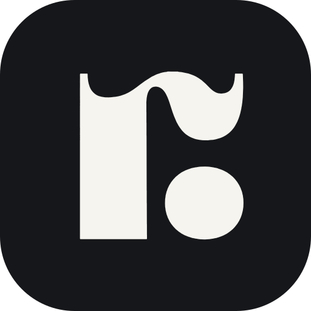

<p align="center">
  <picture>
    <source media="(prefers-color-scheme: dark)" srcset=".github/brand/rankraft-mark-dark-bg.svg">
    
  </picture>
</p>

<h1 align="center">RankRaft AI skill</h1>

<p align="center">An Agent Skill for coding agents working against the <a href="https://rankraft.ai">RankRaft AI</a> API and SDKs.</p>

<p align="center">
  <a href="https://rankraft.ai"><b>rankraft.ai</b></a> &nbsp;·&nbsp;
  <a href="https://docs.rankraft.ai">Docs</a> &nbsp;·&nbsp;
  <a href="https://app.rankraft.ai">Dashboard</a> &nbsp;·&nbsp;
  <a href="https://docs.rankraft.ai/api-reference/introduction">API reference</a>
</p>

It teaches the agent the parts a developer otherwise learns from a 422: that the
report endpoints are POSTs that read, that cursors are bound to the query, that
filter values are strings, which fields each report accepts, what every error
code means, and when to point someone at the MCP server instead of writing code.

**This repo is the skill itself** - `SKILL.md` at the root, plus `references/`
and `scripts/`. It is plain Markdown and one shell script, so any agent that
reads the Agent Skills format can use it. Nothing here is specific to one tool.

## Install

The skill is the repo itself: `SKILL.md` at the root, plus `references/` and
`scripts/`. It follows the open [Agent Skills](https://agentskills.io) format,
so it works with any agent that supports skills, and degrades to plain
instructions for any that do not. Nothing in it is specific to one vendor.

```bash
git clone https://github.com/RankRaft/rankraft-skill
```

**1. Agents that load skills.** Copy the directory into the folder your agent
reads skills from, named `rankraft`:

```bash
cp -r rankraft-skill <your-agent-skills-dir>/rankraft
```

| Agent | Skills directory |
|---|---|
| Claude Code | `.claude/skills/` (project) or `~/.claude/skills/` (all projects) |
| Other Agent Skills clients | see your agent's docs for its skills folder |

**2. Agents that read an instructions file instead** (Codex, Cursor, Copilot,
Gemini CLI, Windsurf and others commonly read `AGENTS.md` or a rules file).
Put the contents of `SKILL.md` in that file, and keep `references/` somewhere
the agent can open. `SKILL.md` links to them by relative path.

**3. Any chat assistant.** Paste `SKILL.md`, and `references/api-reference.md`
if you want exact request shapes, into the conversation.

For Claude Code there is also a managed install, which bundles this same
directory and keeps it up to date:
[RankRaft/rankraft-claude-plugin](https://github.com/RankRaft/rankraft-claude-plugin).

## What is in it

| File | Read it when |
|---|---|
| `SKILL.md` | starting any RankRaft AI task: REST vs MCP, SDK quick starts, the ten rules that bite |
| `references/api-reference.md` | you need exact request/response shapes, filter fields per endpoint, limits |
| `references/errors.md` | handling or explaining an error code |
| `references/recipes.md` | visibility over time, leaderboards, citation share, CSV prompt loads, warehouse exports, 92-day backfills |
| `references/why-the-sdks.md` | deciding whether to call the API by hand |
| `scripts/smoke.sh` | checking a key, its permission and the site ids in one command |

## Keeping it true

The source of truth is `https://api.rankraft.ai/v1/openapi.json`. When the API
changes, the two SDK repos get a pull request from their daily spec-sync
workflow; this repo should follow. Anything here that disagrees with the spec
is a bug - open an issue.

## Licence

MIT

---

RankRaft AI - [rankraft.ai](https://rankraft.ai) · [docs.rankraft.ai](https://docs.rankraft.ai) · hello@rankraft.ai
